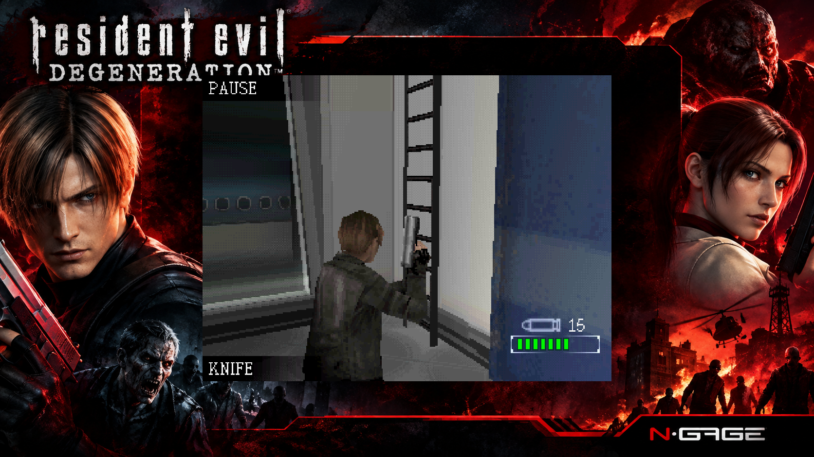
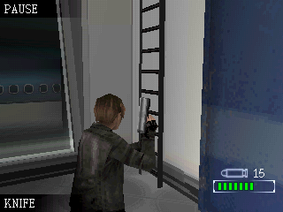
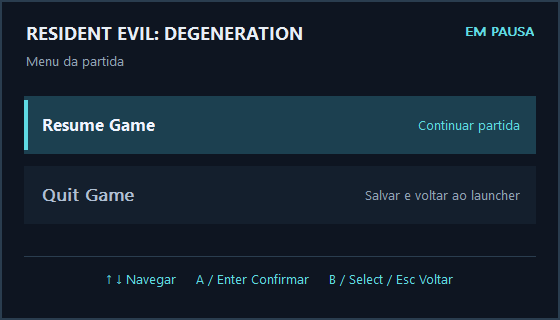
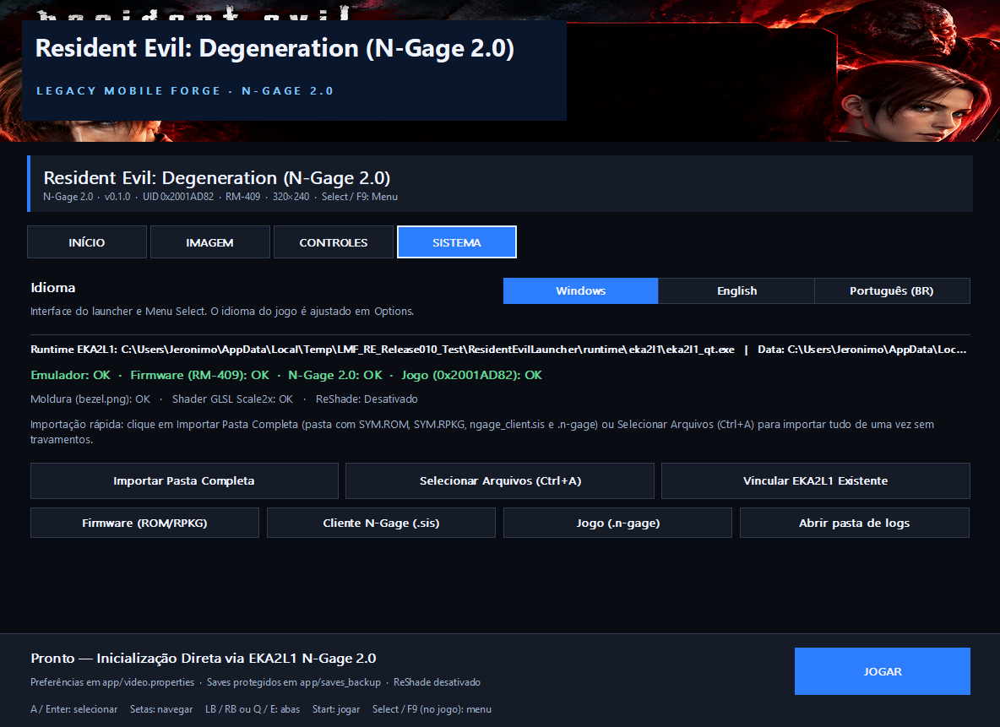
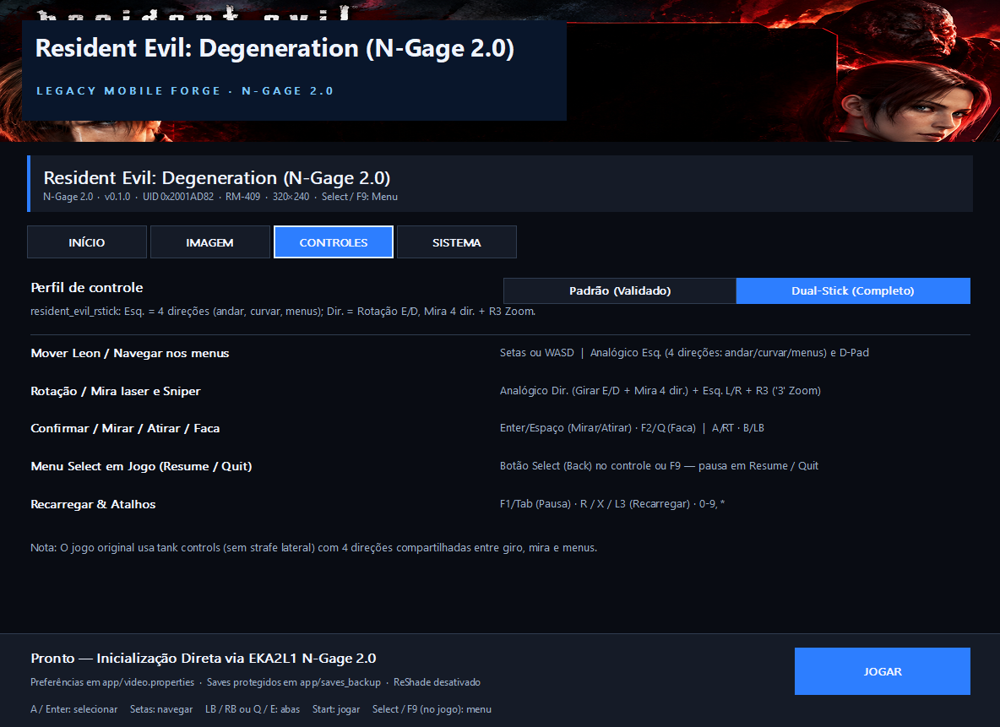
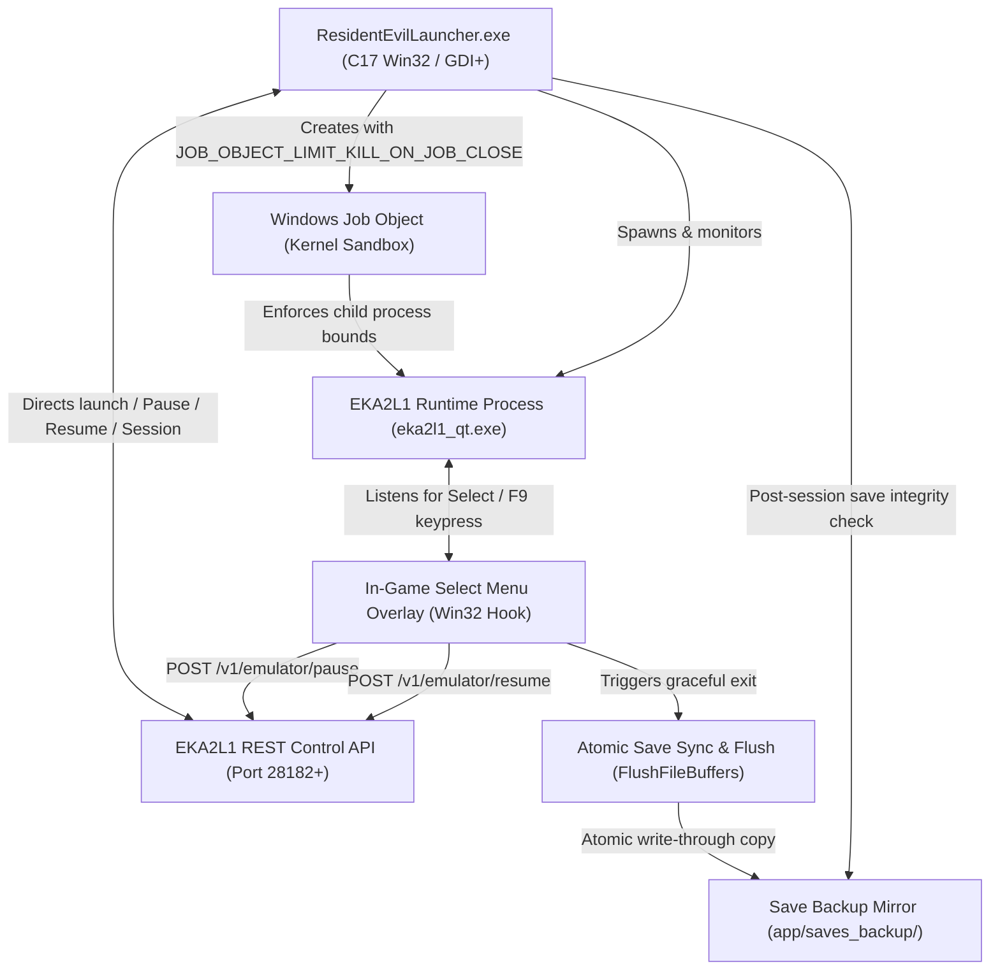

# Resident Evil: Degeneration — N-Gage 2.0 on Windows (Release 0.1.0)

<p align="center">
  
</p>

<p align="center">
  <a href="README.pt-BR.md"><b>🇧🇷 Leia em Português (pt-BR)</b></a> •
  <a href="#key-features"><b>Features</b></a> •
  <a href="#quick-start--setup-guide"><b>Setup Guide</b></a> •
  <a href="#controls--gamepad-mappings"><b>Controls</b></a> •
  <a href="#technical-architecture"><b>Architecture</b></a> •
  <a href="#verification--test-results"><b>Tests</b></a> •
  <a href="#legal-notice"><b>Legal Notice</b></a>
</p>

<p align="center">
  
  
  
  
  
  
</p>

---

## Overview

**Resident Evil: Degeneration (N-Gage 2.0)** is Capcom's atmospheric 3D third-person survival horror title released in 2008 for Symbian S60v3 OS 9.3 (Nokia N-Gage 2.0, UID `0x2001AD82`, target device Nokia 5320d-1 `RM-409`).

This repository provides the **complete, standalone native Windows x64 port and launcher ecosystem** built using **C17 Win32 / GDI+**, an embedded **EKA2L1 portable runtime supervisor**, **Windows Job Objects** process sandboxing, an **in-game Select Menu overlay**, atomic save-state protection, and custom presentation scaling.

> [!IMPORTANT]
> **Strict Copyright & Fair-Use Compliance**: This repository and its releases **contain NO copyrighted ROMs, proprietary Nokia firmware, Capcom game binaries (`.n-gage`/`.sis`), personal saves, or ReShade binary DLLs**. Users must provide their own legitimate firmware and game files, which can be imported in seconds via the unified graphical importer.

---

## Key Features

1. **Direct Game Boot (No Emulation Menus)**:
   - Spawns the Symbian OS runtime and automatically dispatches the game launch payload (`UID 0x2001AD82`) via the EKA2L1 REST Control API and N-Gage PlayServer IPC, jumping straight to the Capcom logo and 3D title screen.
2. **In-Game Select Overlay Menu (`Select` / `Back` / `F9`)**:
   - Inspired by the *Meteos Astroblocks* launcher engine. Pressing `Select` or `Back` on a gamepad (or `F9` on keyboard) pauses the emulation thread pool (`POST /v1/emulator/pause`) and displays a smooth native Win32 overlay with **Resume Game** and **Quit Game**.
   - Safe and clean exit: Quitting flushes all file buffers, notifies the session, and returns cleanly to the launcher.
3. **Windows Job Objects & Zero-Orphan Guarantee**:
   - The emulator child process (`eka2l1_qt.exe`) is assigned to a restricted Windows Kernel Job Object (`JOB_OBJECT_LIMIT_KILL_ON_JOB_CLOSE`). If the launcher closes, crashes, or is killed via Task Manager, Windows immediately and unconditionally terminates all child processes. Zero orphaned processes.
4. **Atomic Save Persistence & Self-Healing**:
   - Game progress (`appdata.i3d`, `userdata.i3d`, `DBMS\myprofile.db`, and `2001AD82\as.dat`) is tracked with pre-shutdown file stabilization (`FlushFileBuffers`) and atomic write-through mirroring (`app/saves_backup/`). Corrupted or 0-byte saves caused by unexpected system power loss are automatically repaired from the latest verified snapshot.
5. **Fast Non-Blocking Unified Importer**:
   - Background worker threads import required files with a **real-time visual progress bar**, eliminating UI freezing:
     - **Import Full Folder**: Select any directory containing `SYM.ROM`, `SYM.RPKG`, `ngage_client.sis`, and `Resident Evil Degeneration.n-gage`.
     - **Select Files (Ctrl+A)**: Multi-file selection dialog to pick all 4 files at once.
     - **Auto-Detection**: Automatically discovers pre-existing Nokia 5320 RM-409 firmware installations in local and roaming app data without re-downloading or duplicating files.
6. **Dual Controller Profiles**:
   - **Default Tank Controls (`resident_evil.yml`)**: Authentic D-Pad and Left Stick movement, face-button aiming and shooting, tested and validated for authentic classic gameplay.
   - **Full Dual-Stick Profile (`resident_evil_rstick.yml`)**: 4-way Left Stick navigation + 4-way Right Stick camera rotation and laser aiming, with `R3` Zoom / Knife and `L3` Reload.
7. **Custom Presentation & Frame**:
   - Pixel-perfect 1080p custom bezel (`1672×941`, ratio 67% viewport = `960×720`), optional Scale2x GLSL filter, windowed or borderless fullscreen mode. ReShade is strictly disabled by default.

---

## Screenshots

<table align="center">
  <tr>
    <td align="center"><b>3D Real-Time Gameplay</b></td>
    <td align="center"><b>In-Game Select Menu Overlay</b></td>
  </tr>
  <tr>
    <td></td>
    <td></td>
  </tr>
  <tr>
    <td align="center"><b>Unified System Importer</b></td>
    <td align="center"><b>Controller Configuration & Dual-Stick</b></td>
  </tr>
  <tr>
    <td></td>
    <td></td>
  </tr>
</table>

---

## Quick Start & Setup Guide

### 1. Requirements
- **OS**: Windows 10 or Windows 11 (64-bit).
- **Controller**: Xbox Controller (XInput), DualShock 4 / DualSense (via DS4Windows or Steam Input), or standard USB Gamepad.
- **Game & Firmware Files (User-Provided)**:
  1. `SYM.ROM` and `SYM.RPKG` (Nokia 5320 XpressMusic RM-409 firmware dump).
  2. `ngage_client.sis` (N-Gage 2.0 application client installer, UID `0x20003B78`).
  3. `Resident Evil Degeneration.n-gage` (or extracted `.sis`, UID `0x2001AD82`).

### 2. Initial Setup
1. Launch **`ResidentEvilLauncher.exe`** (or `jogar_resident_evil.bat`).
2. If any prerequisite files are missing, the launcher will automatically navigate to the **System** tab.
3. Import your files using either:
   - **Import Full Folder**: Put your 4 files in a folder (e.g. `arquivos-necessarios-launcher/`), click the button, and the launcher will parse and install everything in sequence.
   - **Select Files (Ctrl+A)**: Click the button, navigate to your files, select all of them, and click Open.
   - **Link Existing EKA2L1**: If you already have EKA2L1 installed with firmware, point to its directory for instant zero-copy linking.
4. Once the progress bar reaches 100%, switch to the **Display** tab, configure your preferred resolution and filter, and click **PLAY GAME** (`Enter` or `Start`).

### 3. Command-Line Interface (CLI)
```powershell
# Check whether runtime, firmware, and game are valid (exit code 0 = ready, 1 = missing)
.\ResidentEvilLauncher.exe --validate

# Import all prerequisites from a folder automatically
.\ResidentEvilLauncher.exe --import-bundle "C:\Path\To\MyFiles"

# Launch directly into gameplay, bypassing launcher GUI
.\ResidentEvilLauncher.exe --direct
```

---

## Controls & Gamepad Mappings

### A. Default Validated Profile (`resident_evil.yml`)
Preserves the original Capcom control scheme, providing immediate familiarity for classic survival horror players:

| Game Action | Keyboard | Gamepad (SDL2 / XInput) | Symbian Scancode |
|---|---|---|---|
| **Move / Turn / Navigate Menus** | `Arrow Keys` or `W / A / S / D` | `D-Pad` or `Left Stick` | `16` (Up), `17` (Down), `14` (Left), `15` (Right) |
| **Action / Confirm / Aim / Fire** | `Enter`, `Space` or `5` | `Button A` (Cross) or `RT Trigger` | `167` (`EStdKeyDevice3`) / `53` (`'5'`) |
| **Knife / Cancel Aim / Cancel / Jump** | `F2`, `Esc` or `Q` | `Button B` (Circle), `LB` or `LT` | `165` (`Right Softkey`) |
| **Pause / Map 1F / Select Item** | `F1`, `Tab` or `I` | `Start` | `164` (`Left Softkey`) |
| **Select Menu (Resume / Quit)** | `F9` | `Select` / `Back` (reserved) | *Handled by Launcher Overlay* |
| **Reload / Quick Turn / Shortcuts** | `R`, `Backspace`, `0-9`, `*` | `Button X`, `Button Y`, `RB` | `180`, `1`, `48-57`, `42` |

### B. Optional Full Dual-Stick Profile (`resident_evil_rstick.yml`)
Selectable in **Controls → Controller Profile → `Dual-Stick (Full)`**:

- **Left Stick (`303/302/301/300`)**: Full 4-direction movement (`16/17/14/15`), allowing turning while running, walking, and navigating inventory menus. Double-tap back triggers the 180° quick-turn.
- **Right Stick (`305/304/307/306`)**: Horizontal rotation (`14/15`) during exploration + 4-way laser aiming (`14/15/16/17`) while holding the aim button.
- **`R3` (Right Stick Click)**: Sends key `'3'` (`51`), bindable to *Use Knife / Zoom* in the in-game *Options → Controls* menu.
- **`L3` (Left Stick Click)**: Triggers instant weapon reload (`180`).
- **Select / Back (`button_id: 6`)**: Unbound from Symbian key `#` to prevent accidental weapon switching when opening the overlay menu.

> [!NOTE]
> **Original Game Architectural Limitation**: The Symbian N-Gage 2.0 S3E engine (`Resident_Evil.s3e`) natively uses tank controls (no lateral strafing) and exposes only four directional input scancodes (`16, 17, 14, 15`). There is no independent 360° orbital camera in the original game code. Thus, the Dual-Stick profile maps the right stick to rotation and vertical aim adjustment while respecting the authentic physics of the original title.

---

## Technical Architecture



### Process Management Highlights
- **Single-Instance Mutex**: `Local\ResidentEvilDegeneration_InstanceMutex` prevents port collisions and duplicate runtime processes.
- **Dynamic API Port Allocation**: Scans ports `28182` through `28199` to ensure clean communication even if another service is bound.
- **Three-Stage Graceful Shutdown**:
  1. REST shutdown trigger: `DELETE /v1/session`.
  2. Windows messaging close: `WM_CLOSE` dispatched to all EKA2L1 top-level windows.
  3. Kernel enforcement: `TerminateJobObject` guarantees all threads and subprocesses are cleared with zero orphans.

---

## Verification & Test Results

The implementation is verified by an automated regression test suite:

### 1. `Verify-Release010.py` (5/5 PASS)
- `[PASS]` Clean packaging audit: No `.rom`, `.rpkg`, `.sis`, `.n-gage`, `.i3d`, `.db`, or `.zip` leaks.
- `[PASS]` Bundle import verification: Automated ingestion of firmware and game packages.
- `[PASS]` Relative path execution: Launcher operates completely independently of fixed directory paths.
- `[PASS]` In-game Select Menu: Emulation pause, resume, and quit verified via frame polling.
- `[PASS]` Process supervisor: Zero orphaned processes after game termination.

### 2. `Verify-ProcessAndSavesNG.py` (6/6 PASS)
- `[PASS]` Mutex and single-instance enforcement.
- `[PASS]` Graceful exit via standard window close (`WM_CLOSE`).
- `[PASS]` Clean termination when closing the parent launcher.
- `[PASS]` Kernel Job Object termination upon parent crash simulation.
- `[PASS]` Atomic save mirroring and pre-shutdown flushing.
- `[PASS]` Self-healing restoration from snapshot upon save file corruption.

---

## Building from Source

To compile the native launcher from source:

1. Install **Visual Studio 2022** (or MSVC Build Tools) with the C/C++ desktop workload and Windows SDK.
2. Open PowerShell in the repository root:
   ```powershell
   cd forge-integration
   .\Build-LauncherNG.ps1
   ```
3. The compiled binary will be placed at `..\ResidentEvilLauncher.exe`.

---

## Repository Structure

```
resident-emulation/
├── app/
│   ├── assets/
│   │   └── bezel.png               # Custom 1080p illustrated bezel frame
│   ├── launcher-ng.ini             # Default launcher configuration
│   └── video.properties            # Viewport and scaling configuration
├── docs/
│   └── assets/                     # Documentation images and hero cover
├── forge-integration/              # Full C17 source code & build system
│   ├── launcher/
│   │   ├── GameLauncherNG.c        # Main launcher Win32 implementation
│   │   └── LauncherUiNG.h          # Win32 GDI+ UI, progress bars & overlays
│   ├── controls/                   # SDL2 controller mapping profiles
│   ├── presentation/               # Scale2x GLSL shaders & presentation tools
│   ├── Build-LauncherNG.ps1        # MSVC automated compiler script
│   ├── Build-NGageRelease.ps1      # Release packaging & distribution script
│   ├── Verify-Release010.py        # Release compliance & integration test
│   └── Verify-ProcessAndSavesNG.py # Process supervisor & save test suite
├── evidence/                       # Visual proof screenshots and validation captures
├── jogar_resident_evil.bat         # User convenience batch launcher
├── jogar_direto.bat                # Direct boot bypass script
├── CHANGELOG.md                    # Release history and milestone logs
├── README.md                       # English documentation (Primary)
├── README.pt-BR.md                 # Full Brazilian Portuguese documentation
└── .gitignore                      # Strict legal & artifact exclusion rules
```

---

## Legal Notice

- *Resident Evil: Degeneration* is a registered trademark and copyright of **Capcom Co., Ltd.**
- *N-Gage*, *Symbian*, and *Nokia* are trademarks of **Nokia Corporation**.
- *EKA2L1* is an open-source Symbian emulator distributed under the **GNU General Public License v3.0**.
- The native launcher and integration scripts in this repository are distributed under the **MIT License**.
- **No commercial or proprietary game files, firmware ROMs, or copyrighted assets are hosted or distributed in this repository.** All intellectual property belongs to their respective owners.
