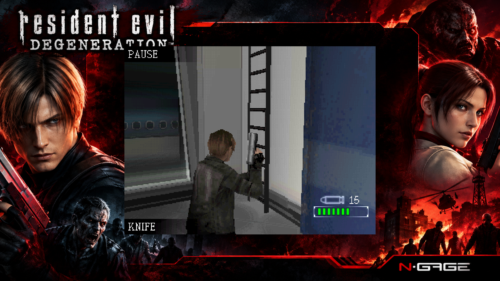
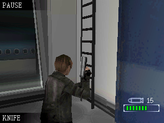
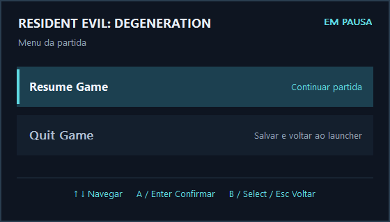
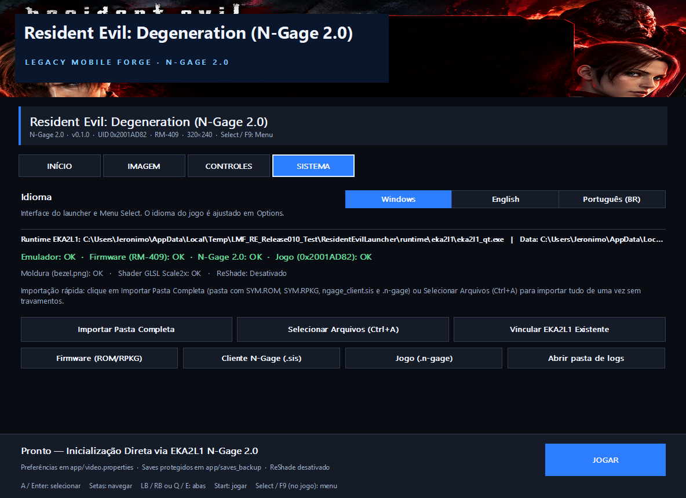
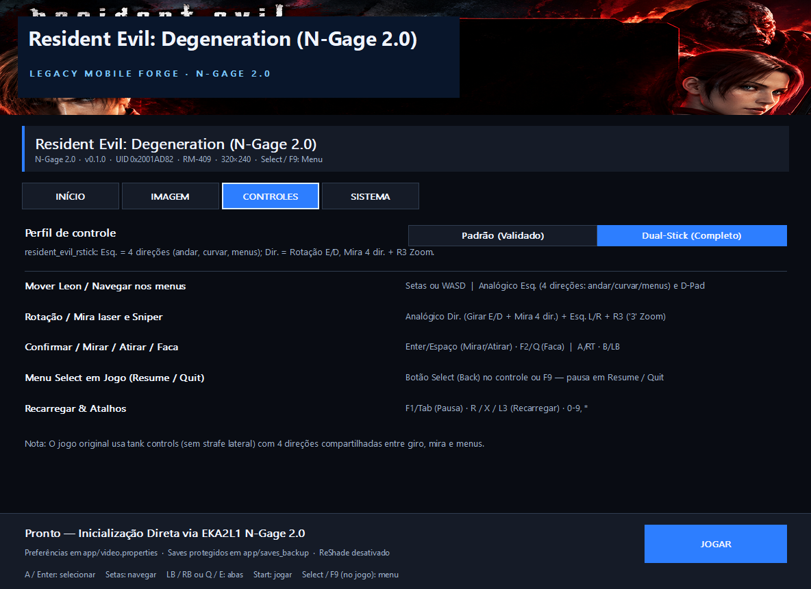
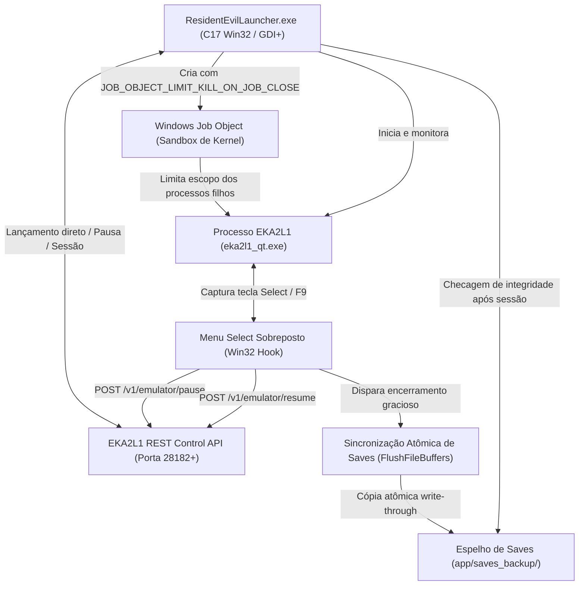

# Resident Evil: Degeneration — N-Gage 2.0 no Windows (Versão 0.1.0)

<p align="center">
  <b>Resident Evil Degeneration para Windows — Experiência autônoma de jogo N-Gage 2.0 baseada no EKA2L1, com suporte a controle, launcher personalizado e apresentação aprimorada.</b>
</p>

<p align="center">
  
</p>

<p align="center">
  <a href="README.md"><b>🇺🇸 English Version</b></a> •
  <a href="#download"><b>Download</b></a> •
  <a href="#principais-recursos"><b>Recursos</b></a> •
  <a href="#guia-rápido-de-instalação-e-uso"><b>Instalação</b></a> •
  <a href="#controles-e-mapeamento-de-gamepad"><b>Controles</b></a> •
  <a href="#arquitetura-técnica"><b>Arquitetura</b></a> •
  <a href="#créditos-e-agradecimentos"><b>Créditos</b></a> •
  <a href="#reportar-bugs-e-feedback"><b>Reportar Bugs</b></a> •
  <a href="#aviso-legal-e-direitos-autorais"><b>Aviso Legal</b></a>
</p>

<p align="center">
  
  
  
  
  
  
</p>

<p align="center">
  <a href="https://github.com/piecarlos/project_degeneration/releases/download/v0.1.0/ResidentEvilDegeneration-0.1.0-windows-x64.zip">
    
  </a>
  <a href="https://github.com/piecarlos/project_degeneration/releases/tag/v0.1.0">
    
  </a>
</p>

---

## Download

> 🚀 **[Download Direto: ResidentEvilDegeneration-0.1.0-windows-x64.zip](https://github.com/piecarlos/project_degeneration/releases/download/v0.1.0/ResidentEvilDegeneration-0.1.0-windows-x64.zip)**  
> *(50.3 MB · Pacote Portátil Pré-configurado para Windows x64 · SHA-256: `7CA6943538F129CCC9745FA5886E36A7C2D594DF572C8DA54B5556F53FDB6C91`)*  
>
> 📌 Todas as versões, histórico de mudanças e arquivos de release estão disponíveis em [GitHub Releases](https://github.com/piecarlos/project_degeneration/releases).

---

## Visão Geral

**Resident Evil: Degeneration (N-Gage 2.0)** é o clássico jogo de *survival horror* em 3D em terceira pessoa desenvolvido pela Capcom em 2008 para a plataforma Symbian S60v3 OS 9.3 (N-Gage 2.0, UID `0x2001AD82`, dispositivo alvo Nokia 5320d-1 `RM-409`).

Este repositório contém um **launcher autônomo para Windows baseado no EKA2L1 (Standalone Windows launcher powered by EKA2L1)**, desenvolvido em **C17 Win32 / GDI+**, com **supervisor portátil de runtime EKA2L1**, isolamento de processos por **Windows Job Objects**, **Menu Select em jogo sobreposto**, proteção atômica de saves e renderização com moldura personalizada e filtros visuais.

> [!IMPORTANT]
> **Conformidade Estrita com Direitos Autorais**: Este repositório e suas versões públicas **NÃO CONTÊM ROMs proprietárias, firmwares da Nokia, binários comerciais do jogo (`.n-gage`/`.sis`), saves pessoais ou DLLs do ReShade**. O usuário deve fornecer suas próprias cópias legítimas do jogo e firmware, as quais são importadas em poucos segundos pelo assistente gráfico unificado.

---

## Principais Recursos

1. **Inicialização Direta do Jogo (Sem Navegação Manual por Menus)**:
   - Inicializa o runtime Symbian e despacha automaticamente o lançamento de `0x2001AD82` via REST Control API e N-Gage PlayServer IPC, exibindo diretamente o logo da Capcom e a tela de título em 3D.
2. **Menu Select Sobreposto em Jogo (`Select` / `Back` / `F9`)**:
   - Inspirado no mecanismo de sobreposição do *Meteos Astroblocks*. Pressionar `Select` ou `Back` no controle (ou `F9` no teclado) pausa os ciclos de emulação (`POST /v1/emulator/pause`) e exibe um menu nativo elegante com opções de **Resume Game** e **Quit Game**.
   - Encerramento gracioso e seguro: sair pelo menu sincroniza os saves, libera a sessão e retorna ao launcher sem processos órfãos.
3. **Windows Job Objects e Garantia de Zero Processos Órfãos**:
   - O processo filho do emulador (`eka2l1_qt.exe`) é associado a um Windows Job Object restrito com `JOB_OBJECT_LIMIT_KILL_ON_JOB_CLOSE`. Caso o launcher seja fechado, travado ou finalizado pelo Gerenciador de Tarefas, o kernel do Windows encerra imediatamente e de forma incondicional todos os processos subordinados.
4. **Persistência Atômica de Saves com Autorrecuperação**:
   - Os arquivos de progresso (`appdata.i3d`, `userdata.i3d`, `DBMS\myprofile.db` e `2001AD82\as.dat`) recebem estabilização de disco (`FlushFileBuffers`) antes do encerramento e espelhamento atômico em `app/saves_backup/`. Saves corrompidos ou zerados decorrentes de quedas abruptas de energia são corrigidos automaticamente com base no último instantâneo válido.
5. **Importador Rápido e Não-Bloqueante com Barra de Progresso**:
   - Processamento em segundo plano (*worker thread*) com **barra de progresso em tempo real**, eliminando congelamentos da interface:
     - **Importar Pasta Completa**: selecione uma pasta contendo os 4 arquivos necessários (`SYM.ROM`, `SYM.RPKG`, `ngage_client.sis` e `Resident Evil Degeneration.n-gage`).
     - **Selecionar Arquivos (Ctrl+A)**: selecione todos os arquivos necessários de uma só vez no explorador de arquivos.
     - **Detecção Automática**: descobre automaticamente instalações prévias do EKA2L1 com firmware Nokia 5320 RM-409 no computador, evitando downloads ou cópias desnecessárias.
6. **Perfis de Controle Pré-Configurados**:
   - **Padrão Validado (`resident_evil.yml`)**: Controles clássicos estilo tanque no D-Pad e analógico esquerdo, mira e tiro nos botões de ação frontais, validado fisicamente em testes de jogabilidade.
   - **Dual-Stick Completo (`resident_evil_rstick.yml`)**: Navegação nas 4 direções no analógico esquerdo + rotação e mira laser livre nas 4 direções no analógico direito, com `R3` para Zoom / Faca e `L3` para Recarregar.
7. **Moldura Ilustrada e Filtros de Apresentação**:
   - Moldura personalizada em 1080p (`1672×941`, proporção 67% viewport = `960×720`), filtro Scale2x GLSL opcional pré-moldura e modos Janela ou Tela Cheia. ReShade permanece estritamente desativado.

---

## Telas do Sistema e Jogo

<table align="center">
  <tr>
    <td align="center"><b>Gameplay 3D em Tempo Real</b></td>
    <td align="center"><b>Menu Select Sobreposto em Jogo</b></td>
  </tr>
  <tr>
    <td></td>
    <td></td>
  </tr>
  <tr>
    <td align="center"><b>Importador Unificado com Barra de Progresso</b></td>
    <td align="center"><b>Configuração de Controles e Dual-Stick</b></td>
  </tr>
  <tr>
    <td></td>
    <td></td>
  </tr>
</table>

---

## Guia Rápido de Instalação e Uso

### 1. Requisitos
- **Sistema Operacional**: Windows 10 ou Windows 11 (64 bits).
- **Controle**: Controle de Xbox (XInput), PlayStation DualShock 4 / DualSense (via DS4Windows ou Steam Input) ou controle USB genérico.
- **Arquivos Fornecidos pelo Usuário**:
  1. `SYM.ROM` e `SYM.RPKG` (Dump do firmware Nokia 5320 XpressMusic RM-409).
  2. `ngage_client.sis` (Instalador do aplicativo N-Gage 2.0, UID `0x20003B78`).
  3. `Resident Evil Degeneration.n-gage` (ou `.sis` do jogo, UID `0x2001AD82`).

### 2. Primeiro Uso
1. Baixe e extraia o pacote **`ResidentEvilDegeneration-0.1.0-windows-x64.zip`** em qualquer pasta gravável.
2. Execute **`ResidentEvilLauncher.exe`** (ou `jogar_resident_evil.bat`).
3. Se faltar algum arquivo de sistema ou do jogo, o launcher abre automaticamente na aba **Sistema**.
4. Importe os arquivos utilizando uma das opções:
   - **Importar Pasta Completa**: aponte para uma pasta com seus 4 arquivos (ex.: `arquivos-necessarios-launcher\`). O launcher detecta, descompacta e registra tudo em sequência com barra de progresso.
   - **Selecionar Arquivos (Ctrl+A)**: clique no botão, navegue até a pasta dos arquivos, selecione todos (`Ctrl+A`) e confirme.
   - **Vincular EKA2L1 Existente**: caso já possua o emulador instalado com firmware, aponte a pasta raiz para vinculação instantânea.
5. Concluída a importação, alterne para a aba **Apresentação**, ajuste resolução e filtro, e clique em **JOGAR** (`Enter` ou `Start`).

### 3. Execução por Linha de Comando (CLI)
```powershell
# Valida se os arquivos necessários estão presentes (código 0 = pronto, 1 = pendente)
.\ResidentEvilLauncher.exe --validate

# Importa os 4 arquivos automaticamente a partir de uma pasta
.\ResidentEvilLauncher.exe --import-bundle "C:\MinhaPasta\Arquivos"

# Executa o jogo diretamente sem abrir a tela do launcher
.\ResidentEvilLauncher.exe --direct
```

---

## Controles e Mapeamento de Gamepad

### A. Perfil Padrão Validado (`resident_evil.yml`)
Preserva o esquema de controle clássico de *survival horror*:

| Ação no Jogo | Teclado | Gamepad (SDL2 / XInput) | Scancode Symbian |
|---|---|---|---|
| **Mover / Girar / Menus** | `Setas` ou `W / A / S / D` | `D-Pad` ou `Analógico Esquerdo` | `16` (Cima), `17` (Baixo), `14` (Esq.), `15` (Dir.) |
| **Ação / Confirmar / Mirar / Atirar** | `Enter`, `Espaço` ou `5` | `Botão A` ou `Gatilho RT` | `167` (`EStdKeyDevice3`) / `53` (`'5'`) |
| **Faca / Cancelar Mira / Voltar / Pular** | `F2`, `Esc` ou `Q` | `Botão B`, `LB` ou `LT` | `165` (`Right Softkey`) |
| **Pausa / Mapa 1F / Item** | `F1`, `Tab` ou `I` | `Start` | `164` (`Left Softkey`) |
| **Menu Select (Resume / Quit)** | `F9` | `Select` / `Back` (reservado) | *Processado pelo Launcher* |
| **Recarregar / Giro 180° / Atalhos** | `R`, `Backspace`, `0-9`, `*` | `Botão X`, `Botão Y`, `RB` | `180`, `1`, `48-57`, `42` |

### B. Perfil Opcional Dual-Stick Completo (`resident_evil_rstick.yml`)
Selecionável na aba **Controles → Perfil de controle → `Dual-Stick (Completo)`**:

- **Analógico Esquerdo (`303/302/301/300`)**: Movimento e curvas nas 4 direções (`16/17/14/15`), garantindo navegação suave e uso dos menus e inventário. Toque duplo para trás executa o giro rápido de 180°.
- **Analógico Direito (`305/304/307/306`)**: Rotação horizontal (`14/15`) na exploração e mira laser livre nas 4 direções (`14/15/16/17`) com a arma empunhada.
- **`R3` (Clique Analógico Direito)**: Dispara scancode `'3'` (`51`), associável a *Use knife / Zoom* no menu de opções do jogo.
- **`L3` (Clique Analógico Esquerdo)**: Recarrega a arma (`180`).
- **Select / Back (`button_id: 6`)**: Desvinculado da tecla `#` do Symbian para evitar troca involuntária de armas ao abrir o menu sobreposto.

> [!NOTE]
> **Limitação Intrínseca do Jogo Original**: O motor original Symbian S3E (`Resident_Evil.s3e`) foi projetado com *tank controls* (sem *strafe* lateral) e suporta estritamente quatro entradas direcionais (`16, 17, 14, 15`), sem câmera orbital de 360° no código nativo. O perfil Dual-Stick Completo mapeia inteligentemente a rotação e a mira ao analógico direito respeitando a física original do jogo.

---

## Arquitetura Técnica



---

## Testes e Validação

A estabilidade e integridade da aplicação são verificadas por duas suítes automatizadas de testes de regressão:

### 1. `Verify-Release010.py` (5/5 PASS)
- `[PASS]` Auditoria de empacotamento: ausência de ROMs, firmwares, jogos ou saves privados vazados.
- `[PASS]` Importação em lote: ingestão automática de pacotes de firmware e jogo.
- `[PASS]` Execução em caminhos relativos: portabilidade comprovada em pastas arbitrárias.
- `[PASS]` Menu Select em jogo: pausa, retomada e saída com monitoramento de taxa de quadros.
- `[PASS]` Supervisor de processos: zero processos órfãos após o fechamento.

### 2. `Verify-ProcessAndSavesNG.py` (6/6 PASS)
- `[PASS]` Mutex e garantia de instância única.
- `[PASS]` Fechamento gracioso via `WM_CLOSE`.
- `[PASS]` Encerramento limpo ao fechar o launcher pai.
- `[PASS]` Término imediato via Job Object em caso de queda forçada do launcher.
- `[PASS]` Espelhamento atômico de saves com `FlushFileBuffers`.
- `[PASS]` Autorrecuperação automática ao detectar arquivos de save corrompidos ou zerados.

---

## Créditos e Agradecimentos

- **Projeto EKA2L1 e Contribuidores** ([EKA2L1 no GitHub](https://github.com/EKA2L1/EKA2L1)): Pelo emulador de código aberto do Symbian OS / N-Gage 2.0, emulação de CPU e REST Control API. Agradecimentos especiais a `bentokun`, `shadowe32` e toda a equipe do projeto.
- **Equipe libSDL** ([libsdl.org](https://www.libsdl.org/)): Pela biblioteca Simple DirectMedia Layer (SDL2) e pela base de mapeamento de controles (`gamecontrollerdb.txt`).
- **Projeto Qt** ([qt.io](https://www.qt.io/)): Pelo framework e plugins de plataforma do Qt6.
- **Desenvolvedores FFmpeg** ([ffmpeg.org](https://ffmpeg.org/)): Pelas bibliotecas de decodificação de áudio e vídeo (`libavcodec`, `libavformat`, etc.).
- **Andrea Mazzoleni** ([scale2x.it](http://www.scale2x.it/)): Pelo algoritmo de escala pixel-art Scale2x.
- **Capcom Co., Ltd.**: Pela criação da obra original *Resident Evil: Degeneration* para celulares.
- **Nokia Corporation**: Pela histórica plataforma de jogos N-Gage 2.0 e sistema Symbian.

---

## Reportar Bugs e Feedback

Encontrou algum problema ou tem sugestões de melhoria?
- **Relatório de Bug**: Abra uma issue utilizando nosso [Modelo de Bug Report](https://github.com/piecarlos/project_degeneration/issues/new?template=bug_report.md). Informe a versão do seu Windows, modelo do controle e o log do launcher (`app/logs/launcher-ng.log` se houver).
- **Sugestão de Funcionalidade**: Sugira novas melhorias pelo [Modelo de Feature Request](https://github.com/piecarlos/project_degeneration/issues/new?template=feature_request.md).
- **Aviso de Privacidade**: Por favor, **NÃO anexe ROMs, dumps de firmware, arquivos comerciais do jogo ou saves pessoais** em issues públicas.

---

## Compilação a Partir do Código-Fonte

1. Instale o **Visual Studio 2022** (ou MSVC Build Tools) com suporte a C/C++ e o Windows SDK.
2. Abra o PowerShell na raiz do projeto:
   ```powershell
   cd forge-integration
   .\Build-LauncherNG.ps1
   ```
3. O binário compilado será gerado em `..\ResidentEvilLauncher.exe`.

---

## Estrutura do Repositório

```
project_degeneration/
├── .github/
│   └── ISSUE_TEMPLATE/            # Modelos de issues do GitHub (Bug Report, Feature Request)
├── app/
│   ├── assets/
│   │   └── bezel.png               # Moldura ilustrada personalizada 1080p
│   ├── launcher-ng.ini             # Configurações padrão do launcher
│   └── video.properties            # Configuração de viewport e proporção
├── docs/
│   └── assets/                     # Imagens da documentação e imagem de capa
├── forge-integration/              # Código-fonte em C17 e automações
│   ├── launcher/
│   │   ├── GameLauncherNG.c        # Código-fonte principal Win32 do launcher
│   │   └── LauncherUiNG.h          # Interface gráfica Win32 GDI+, progresso e menus
│   ├── controls/                   # Perfis de controle SDL2
│   ├── presentation/               # Shaders GLSL Scale2x e ferramentas
│   ├── Build-LauncherNG.ps1        # Script de compilação MSVC
│   ├── Build-NGageRelease.ps1      # Script de empacotamento de distribuição
│   ├── Verify-Release010.py        # Teste de conformidade de release
│   └── Verify-ProcessAndSavesNG.py # Teste de processos e saves
├── jogar_resident_evil.bat         # Atalho de execução rápida
├── jogar_direto.bat                # Atalho para inicialização direta
├── CHANGELOG.md                    # Histórico detalhado de versões
├── LICENSE                         # Licenças do projeto (GPLv3 / MIT)
├── THIRD-PARTY.md                  # Notificações de terceiros e links para o código-fonte
├── SOURCES.txt                     # Fontes upstream e hashes de verificação
├── README.md                       # Documentação principal em Inglês
├── README.pt-BR.md                 # Documentação completa em Português
└── .gitignore                      # Regras de exclusão de binários e saves
```

---

## Aviso Legal e Direitos Autorais

- *Resident Evil: Degeneration* é marca registrada e propriedade intelectual da **Capcom Co., Ltd.**
- *N-Gage*, *Symbian* e *Nokia* são marcas registradas da **Nokia Corporation**.
- *EKA2L1* é um emulador de código aberto sob licença **GNU General Public License v3.0**.
- O launcher nativo e os scripts de integração deste repositório são distribuídos sob a **Licença MIT**.
- **Nenhum arquivo comercial ou protegido por direitos autorais acompanha este repositório.** Todos os direitos pertencem aos seus respectivos proprietários.
